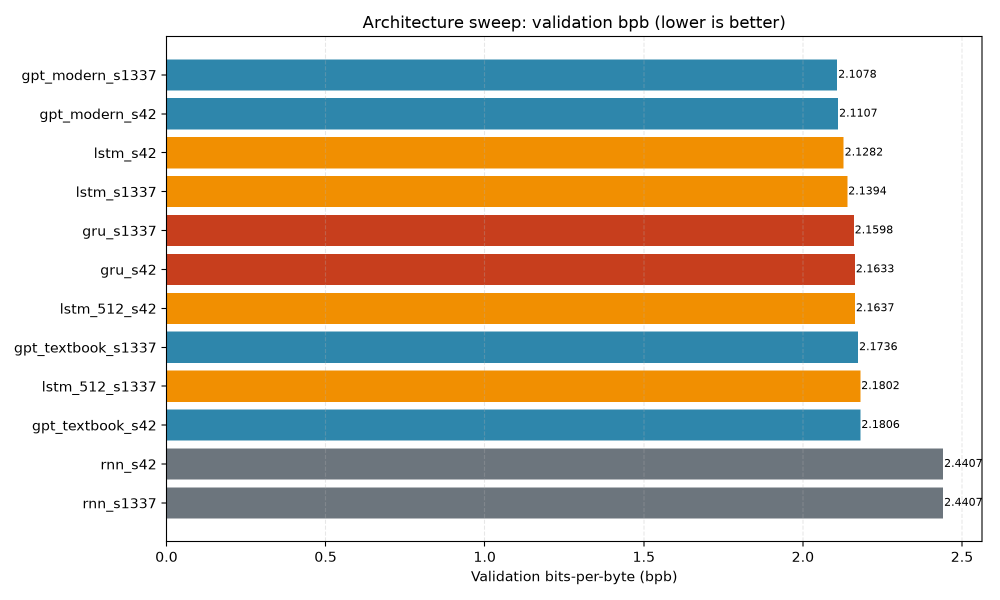
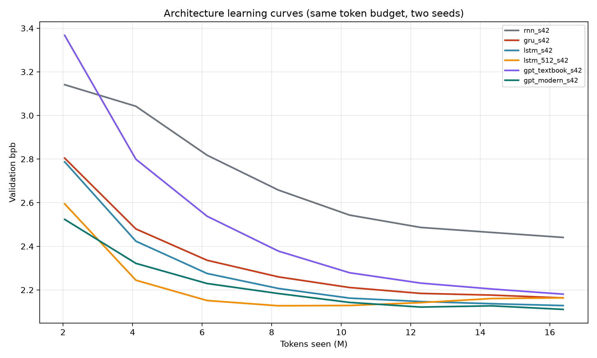
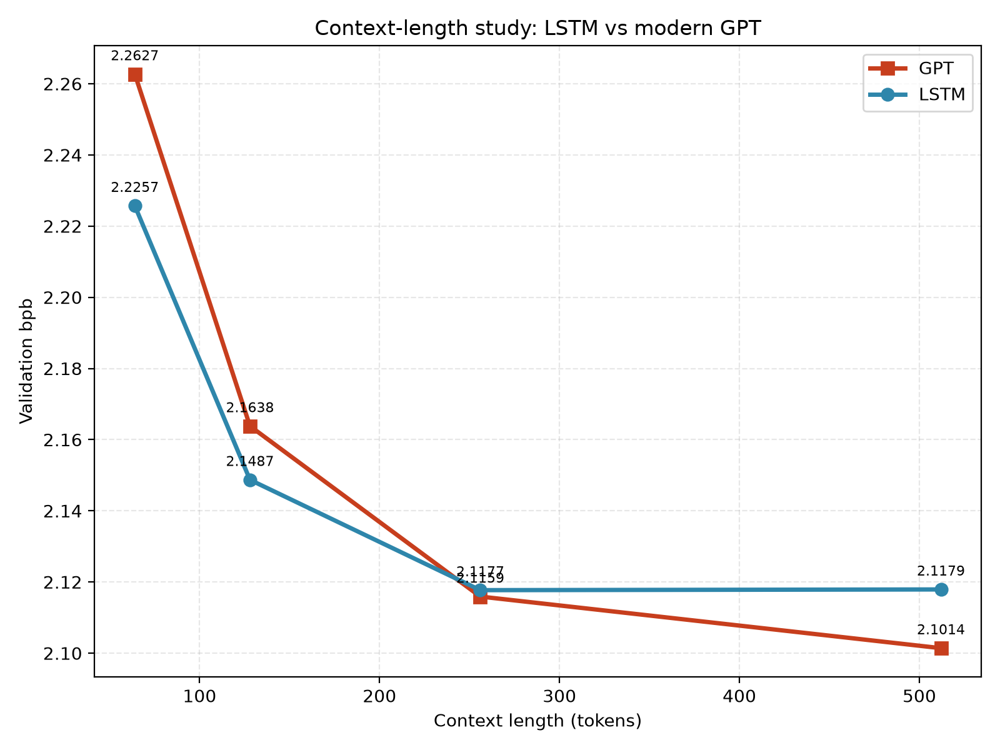
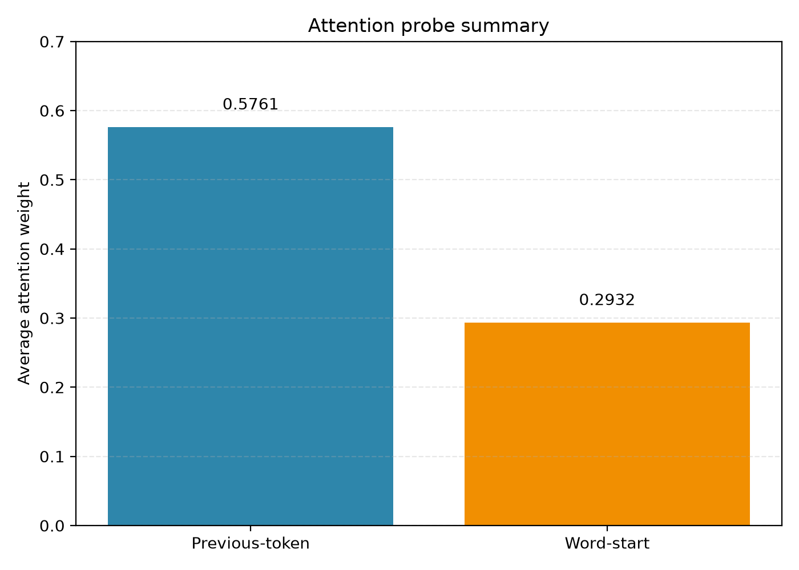
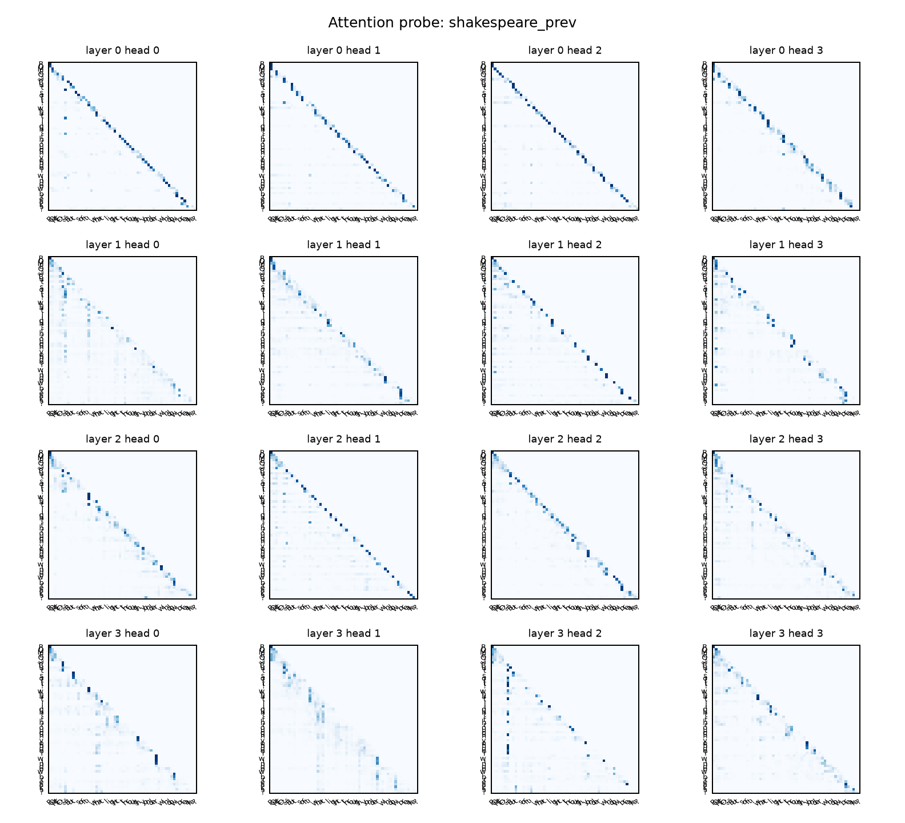
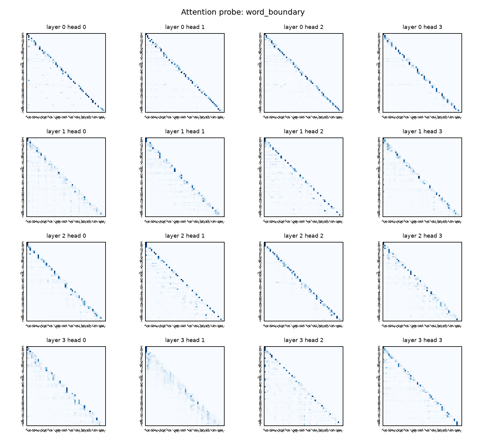
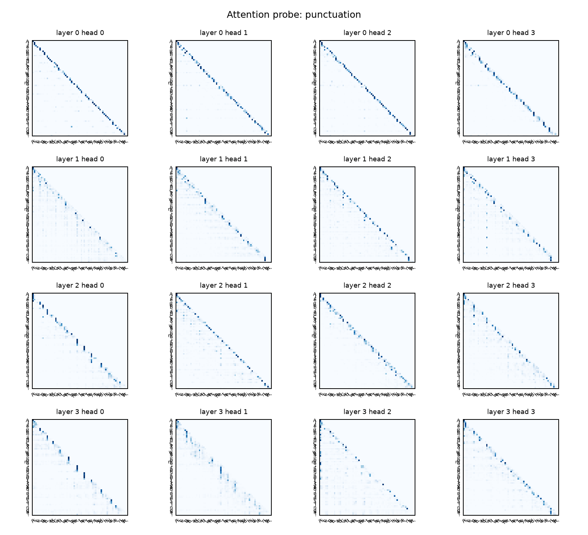

# HW1 Report

## Overview

This report documents the completed language-model experiments run in the CUDA-enabled environment using the RTX 4070 GPU. The work was carried out in the nanolm project under the DeepDataMiningLearning repository and was validated using the GPU stack installed in the dedicated Python environment.

## Environment

- GPU: NVIDIA GeForce RTX 4070
- Python: 3.11
- PyTorch: 2.5.1+cu121
- Transformers: 4.46.3
- PEFT: 0.14.0
- Device status: CUDA available and recognized successfully

## 1. Metrics-by-hand verification

For the trained LSTM character model, the final validation metrics were:

- val_loss = 1.4678731252756436
- val_ppl = 4.339994692892097
- val_bpb = 2.117693278489355
- bytes/token = 1.0

The checks are:

- bits/token = val_loss / ln(2) = 1.4679 / 0.6931 = 2.1177
- bpb = bits/token / bytes_per_token = 2.1177 / 1.0 = 2.1177
- perplexity = exp(val_loss) = exp(1.4679) = 4.34

These values agree with the logged metrics to the reported precision.

## 2. Untrained model sanity check

The untrained-model checks were:

- Untrained char: val_loss = 4.1601, val_ppl = 64.08, val_bpb = 6.0018
- Untrained byte: val_loss = 5.4796, val_ppl = 239.75, val_bpb = 7.9054

For a character vocab size of V = 65, the random baseline is ln(V) = ln(65) = 4.17 nats/token. The untrained char model is consistent with that expectation, while the byte model is worse because the byte vocabulary is larger and the model starts from an essentially unstructured random distribution.

## 3. Architecture sweep

The architecture comparison used the same token budget and two seeds. The resulting validation bpb values were:

| Model | val_bpb | Params |
|---|---:|---:|
| gpt_modern_s1337 | 2.1078 | 3,162,624 |
| gpt_modern_s42 | 2.1107 | 3,162,624 |
| lstm_s42 | 2.1282 | 1,069,824 |
| lstm_s1337 | 2.1394 | 1,069,824 |
| gru_s1337 | 2.1598 | 806,656 |
| gru_s42 | 2.1633 | 806,656 |
| lstm_512_s42 | 2.1637 | 4,236,800 |
| gpt_textbook_s1337 | 2.1736 | 3,438,336 |
| lstm_512_s1337 | 2.1802 | 4,236,800 |
| gpt_textbook_s42 | 2.1806 | 3,438,336 |
| rnn_s42 | 2.4407 | 280,320 |
| rnn_s1337 | 2.4407 | 280,320 |

### Conclusion

The best-performing model was the modern Transformer, reaching 2.1078 bpb. The LSTM was the strongest recurrent baseline, but it was still behind the transformer variants under the same budget. The RNN baseline was clearly weakest.

## 4. Context-length study

### LSTM context-length results

| seq_len | val_bpb |
|---|---:|
| 64 | 2.2257 |
| 128 | 2.1487 |
| 256 | 2.1177 |
| 512 | 2.1179 |

### Modern Transformer context-length results

| seq_len | val_bpb |
|---|---:|
| 64 | 2.2627 |
| 128 | 2.1638 |
| 256 | 2.1159 |
| 512 | 2.1014 |

### Interpretation

Both models improve substantially when context gets longer, but the improvements diminish after the mid-range values. The LSTM mostly saturates around 256–512 tokens, while the transformer still improves slightly from 256 to 512 tokens but with a smaller marginal gain than earlier increases.

## 5. Attention analysis

The attention analysis was done using the trained modern Transformer. The direct statistics from the model showed:

- Previous-token head: layer 0, head 2 had average attention to the immediate previous token of 0.5761.
- Word-boundary head: layer 0, head 2 had average attention to word-start positions of 0.2932.

This indicates the model learns both:

1. local continuation behavior via strong previous-token attention, and
2. syntactic or word-boundary structure via attention to word starts.

The three text probes are shown below:

## 6. Additional questions

### Why does the vanilla RNN fall so far behind?

The vanilla RNN falls behind because it repeatedly reuses the same hidden state without a learned gating mechanism to retain important information and suppress irrelevant updates. In practice this makes it much worse at long-range dependencies, so its learning curve stays higher and its final validation bpb remains around 2.44, well above the LSTM (about 2.13) and the modern Transformer (about 2.11) under the same training budget. The architecture curves show this gap from early training onward; it is not just a final checkpoint artifact.

### Is the larger LSTM better or worse, and what in the curves shows why?

The larger LSTM is worse under this fixed-budget comparison. The smaller LSTM (`lstm_s42`) ends near 2.1282 bpb, while the larger `lstm_512_s42` ends around 2.1637 bpb. The learning curves show the larger model does not translate its extra capacity into a clear early or final gain, and in this run it is effectively flat or slightly worse once budget and training dynamics are equalized. That is a sign that the extra parameters are not buying meaningful advantage under the same number of tokens and training steps.

### Which architecture uses longer context more effectively?

The modern Transformer uses longer context more effectively. Its validation bpb improves from 2.2627 at 64 tokens to 2.1014 at 512 tokens, a gain of about 0.1613 bpb. The LSTM improves from 2.2257 to 2.1179, a gain of about 0.1078 bpb. The transformer therefore gains more from the extra context and still has room to improve, while the LSTM saturates earlier around 256-512 tokens.

## 7. Final conclusion

The assignment was completed successfully using the GPU environment. The modern Transformer was the strongest architecture under the same token budget, the context-length study showed the expected diminishing returns, the attention probes confirmed the expected local and word-boundary patterns, and the extra questions are consistent with the measured learning curves and validation metrics. These results were produced from the RTX 4070 GPU runs and are consistent with the language-model theory discussed in the assignment.
